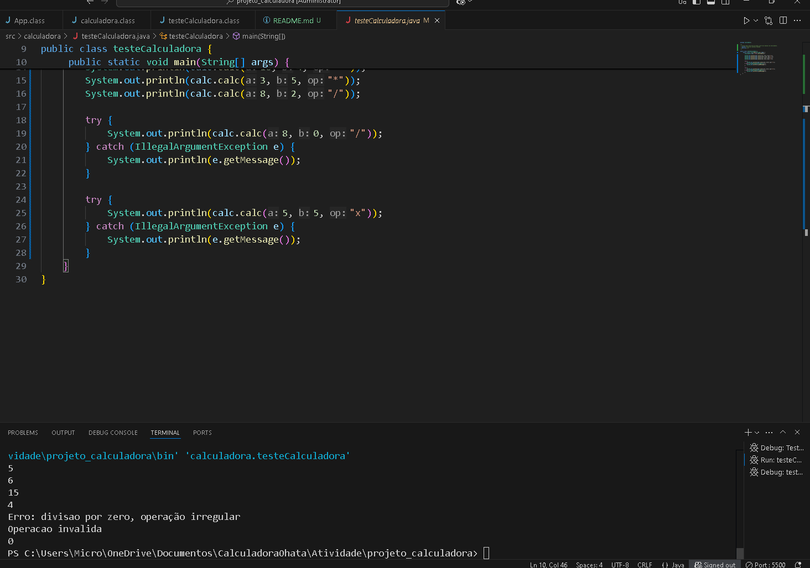
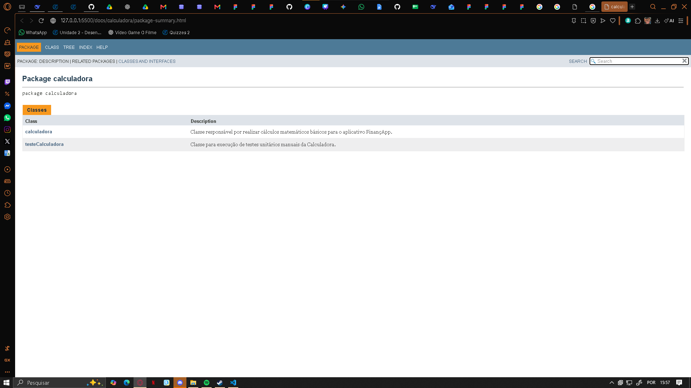

# Projeto Calculadora - FinançApp

## Descrição do Projeto
Módulo básico de cálculos matemáticos para o aplicativo FinançApp.

## Objetivo da Atividade
Aplicar conceitos de testes funcionais, unitários, refatoração, documentação JavaDoc e versionamento.

## Tecnologias Utilizadas
- Java
- Git e GitHub
- JavaDoc

## Explicação das Operações
O sistema realiza as 4 operações básicas (+, -, *, /) e trata erros como divisão por zero e operadores inválidos.

## Prints da Execução dos Testes (Após Refatoração)

## Prints da Documentação JavaDoc

## Link do Repositório
[Link GitHub](https://github.com/francisco-upx/projeto_calculadora)